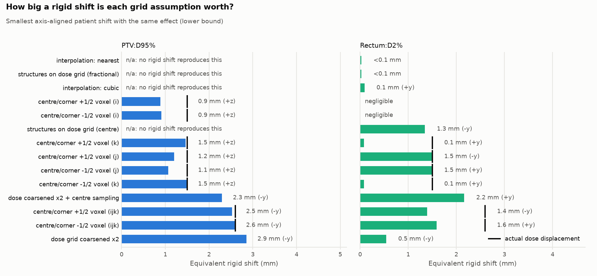
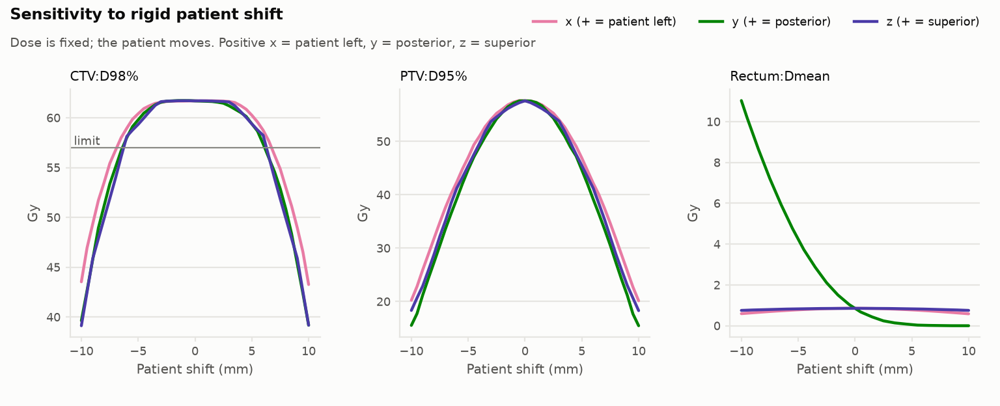
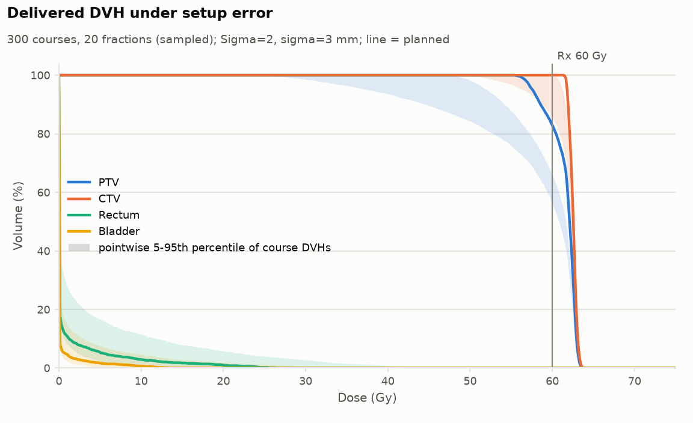
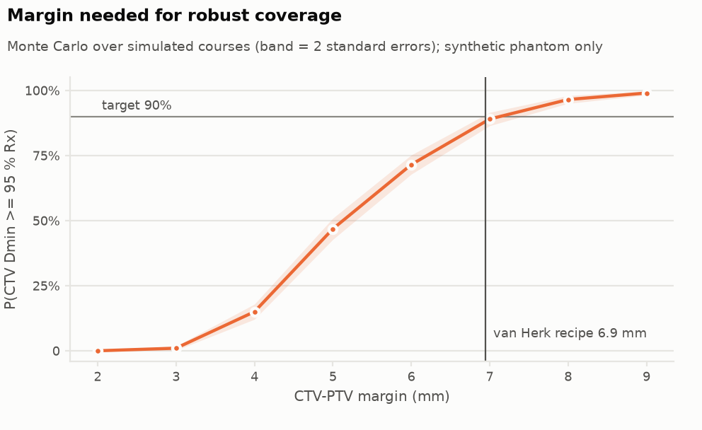
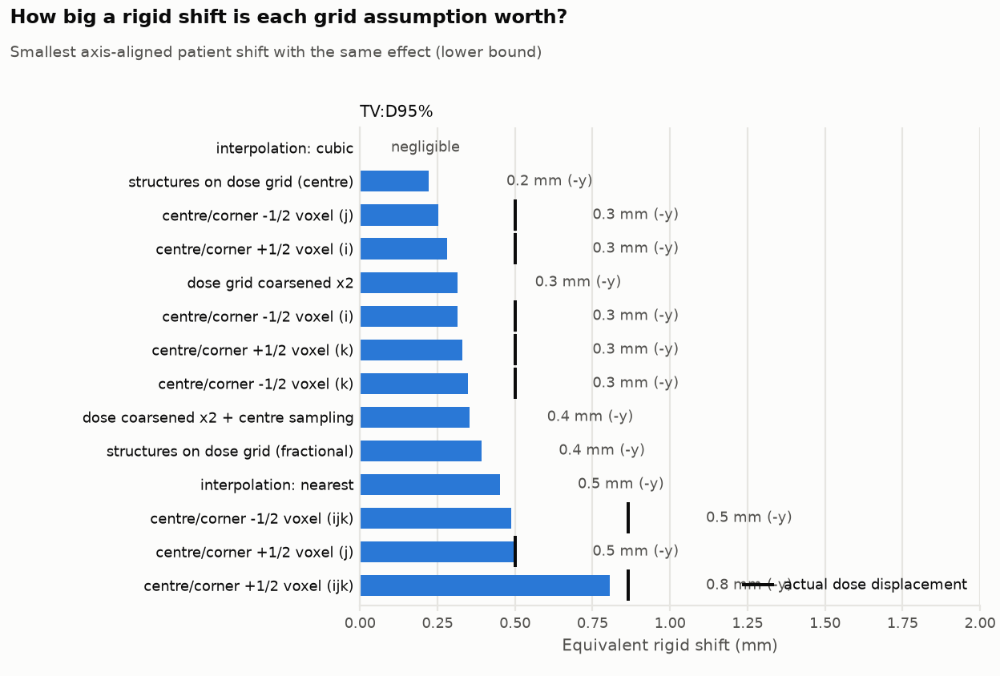
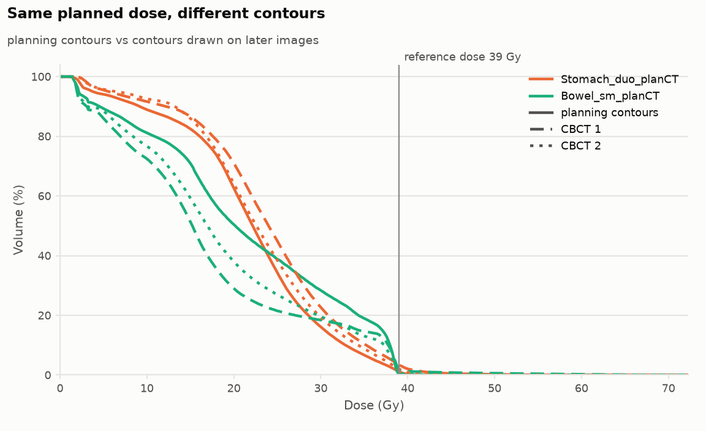
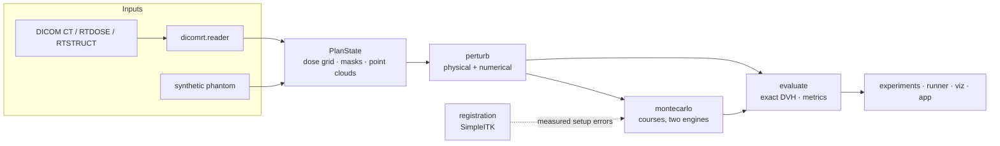

# DoseShift Explorer

**Radiotherapy dose robustness under geometric uncertainty.**
Explore how controlled geometric perturbations and dose-grid alignment assumptions change DVHs and
plan-quality metrics.

`Python` · `DICOM-RT` · `image registration (SimpleITK)` · `Monte Carlo` · `visualization`

> **Research and teaching tool. Not validated for clinical use and not a treatment-planning system.**
> It does not recompute dose; read [docs/limitations.md](docs/limitations.md) before using any number.

---

## The idea

A DVH is only as trustworthy as the geometry underneath it. Two very different things can move a
DVH, and they are usually studied separately:

| | What changes | Example | Class |
|---|---|---|---|
| **Physical** | the patient is not where the plan assumed | 3 mm setup error, 2° roll, anatomical deformation | `kind = "physical"` |
| **Numerical** | the patient *is* where planned, but the pipeline reads the grids differently | voxel centre vs corner, dose resolution, interpolation, structures sampled on the dose grid | `kind = "numerical"` |

DoseShift Explorer treats both as the same object, a pure `PlanState -> PlanState` perturbation,
so they can be composed, swept, and put on **one axis**: *"this grid assumption changes PTV D95 as
much as a 2.5 mm rigid shift would."* (The equivalent shift is a sign-aware **lower bound**, see
[docs/design.md](docs/design.md).)

## What you get

All figures below come from `doseshift demo` on the bundled synthetic phantom (no patient data).
They illustrate mechanisms; they are **not clinical findings**.

**1. Which grid assumptions matter, and what do they cost?**
([`audit_equivalence.png`](docs/img/audit_equivalence.png))



On this 3 mm dose grid, a half-voxel convention error (treating DICOM `ImagePositionPatient`, a
voxel *centre*, as a corner) *is* a 2.6 mm displacement of the dose (black ticks in the figure). It
lowers PTV D95 by about 3.5 Gy, what an axis-aligned 2.5 mm shift costs, and raises rectum D2% by about
8.6 Gy, which a 1.4 mm shift toward the PTV also does: the equivalent is a lower bound, and the rectum
sits in the steepest gradient. Conventions that are not displacements (2× coarsening: PTV D95 −4.6 Gy,
about 2.9 mm) are where the equivalent shift is informative. Where a convention *raises* target
coverage there is no rigid-shift equivalent (shown as n/a). CTV D98 inside the plateau barely
notices: ≤ 0.08 Gy for every convention choice except 2× dose coarsening (0.5 Gy).

**2. Deterministic sensitivity to patient shift** ([`sweep.png`](docs/img/sweep.png))



**3. Delivered DVH over simulated courses** ([`mc_dvh_band.png`](docs/img/mc_dvh_band.png))



With Σ = 2 mm systematic and σ = 3 mm random error over 20 fractions and a 5 mm CTV-PTV margin,
P(CTV D98 ≥ 95 % Rx) = 0.76 ± 0.025 (binomial standard error, 300 courses) even though the planned DVH
passes.

**4. The Monte Carlo is consistent with van Herk's margin recipe (under the phantom's assumptions)** ([`margin_scan.png`](docs/img/margin_scan.png))



At a 7 mm margin (the recipe gives 6.95 mm; the scan uses whole millimetres) the simulated probability
that the CTV minimum dose stays ≥ 95 % Rx is 0.89 ± 0.013, against the recipe's 90 % design target. **Treat this as a consistency check, not a
validation:** an independent reviewer found it moves between 0.79 and 0.91 when mask resolution,
dose-grid spacing, the dose plateau level or the fraction model are changed one at a time
([docs/experiments.md](docs/experiments.md), R4). `margin_scan` runs on the synthetic phantom only and
is not a tool for choosing clinical margins.

## Quick start

```bash
python -m venv .venv && source .venv/bin/activate
pip install -e ".[all]"          # core + SimpleITK + Streamlit + pytest/ruff
pytest                           # 183 tests (178 + 5 skipped without the downloaded data), ~40 s
doseshift demo                   # all four experiments -> outputs/demo/
streamlit run app/streamlit_app.py
```

Without extras, `pip install -e .` gives the library, CLI, DICOM-RT I/O and plots. `scripts/`, `app/`
and `experiments/` live in the repository, not in the installed package, so use a clone for those.

```python
from doseshift.synthetic import make_state
from doseshift.perturb import RigidShift, DoseGridOffset, Compose
from doseshift.evaluate import evaluate

state = make_state()
planned = evaluate(state)
shifted = evaluate(RigidShift((0, 3, 0))(state))  # patient moves 3 mm posterior
misread = evaluate(DoseGridOffset((0.5, 0.5, 0.5))(state))  # dose grid read half a voxel off
print(planned.flat()["PTV:D95%"], shifted.flat()["PTV:D95%"], misread.flat()["PTV:D95%"])
```

## Real data

Five patients from two public TCIA collections (CC BY 4.0) are wired in: Gamma Knife radiosurgery
(MR, 1 mm dose grid, RTPLAN with the prescription) and pancreas SBRT (CT, planning dose plus
CBCT-day contours). Details, citations, and what was *not* downloaded and why:
[data/README.md](data/README.md).

```bash
python scripts/download_tcia.py Vestibular-Schwannoma-SEG data/raw/vs-seg VS-SEG-154   # dry run; --yes to fetch
doseshift discover data/raw/vs-seg/VS-SEG-154 --roles TV=ptv,Cochlea=oar --write-config my_case.yaml
doseshift run my_case.yaml
```

`discover` pairs image ↔ RTSTRUCT ↔ RTPLAN ↔ RTDOSE from the references stored in the DICOM headers
(file names do not say), and reads the prescription from the RTPLAN. `inspect` reports
FrameOfReferenceUID agreement, grid specs, the sub-voxel phase between image and dose grids, and
whether the RTSTRUCT actually references the loaded image series.

What the real data showed, in brief ([docs/experiments.md](docs/experiments.md), R5-R6):

- A half-voxel grid error is a displacement of the dose of 0.87 mm on the 1 mm Gamma Knife grids and
  1.2-2.3 mm on the pancreas grids (by construction). Its cost in dose is largest for the small tumour:
  up to 1.6 Gy, 12 % of the 13 Gy prescription for a 1 cc tumour, against about 3 % for the pancreas
  target's D95. Four plans cannot tell whether that scales with voxel size or with site and gradient.
- On a single plan the cost grows with voxel size (roughly linearly for gradient-limited metrics), but
  the cost per millimetre differs 25-fold between plans and metrics (R7).
- Unlike the phantom, mean dose of the real OARs is also grid-sensitive (up to ~5 %), not only D2%.
- Redrawn pancreas organ contours on CBCT-day images (planning dose fixed) are worth at least 2.5-5.4 mm
  of rigid shift for stomach/duodenum D2% in one patient (a lower bound; the centroids moved 5-9 mm),
  and in the other differ so much in volume (1.7-4.7×) that no rigid-equivalent is reported.
- CT-to-CBCT mutual-information registration is validated on known motions, but on the real pancreas CBCTs
  only 1 of 4 registrations has a well-defined optimum and none can give a setup error (R8).




*Figures are metrics computed by this code from VS-SEG-135 (Shapey et al. 2021,
[doi:10.7937/TCIA.9YTJ-5Q73](https://doi.org/10.7937/TCIA.9YTJ-5Q73)) and Pancreas-CT-CB_017 (Hong et al.
2021, [doi:10.7937/TCIA.ESHQ-4D90](https://doi.org/10.7937/TCIA.ESHQ-4D90)), both from TCIA under
[CC BY 4.0](https://creativecommons.org/licenses/by/4.0/); the plots are derived/transformed material
and no image data is redistributed in this repo. Full citations: [data/README.md](data/README.md).*

## Experiments

| `experiment:` | Question | Output |
|---|---|---|
| `sweep` | How do metrics respond to rigid shifts along x, y, z? | `sweep.csv/png` |
| `grid_audit` | How large is each grid assumption, in mm of setup error? | `audit*.csv`, `audit_equivalence.png`, `dvh_scenarios.png` |
| `monte_carlo` | What is P(constraint met) under random + systematic error? | `mc_*.csv`, `mc_dvh_band.png`, `mc_hist.png` |
| `margin_scan` | What CTV-PTV margin is needed? (validation) | `margin_scan.csv/png` |
| `contour_variation` | How much does an organ's dose change when its contour is redrawn on a later image (dose fixed), in mm of rigid shift? | `contour_variation.csv`, `dvh_contours.png`, `contour_equivalence.png` |
| `resolution_scan` | Does the cost of a half-voxel error scale with voxel size? (one plan, dose coarsened 1-4×) | `resolution_scan.csv/png` |

Every run also writes `geometry.png`, `nominal.csv` and `provenance.json` (config, resolved defaults,
package versions, and for DICOM runs the input UIDs and file hashes); `doseshift run outputs/x/provenance.json`
re-runs it. Real-data runs do not draw image slices unless the config sets `show_image: true`, so
shared outputs do not embed patient anatomy by accident.
Hypotheses and run instructions: [docs/experiments.md](docs/experiments.md).

## Architecture



```
src/doseshift/
  geometry.py       Grid (index<->world affine), RigidMotion
  state.py          DoseGrid, MaskStructure, PointCloud, PlanState (immutable)
  perturb/          rigid.py (physical)  grid.py (numerical)  base.py (Compose)
  dvh.py            exact weighted cumulative DVH
  metrics.py        metric grammar (D95%, V20Gy, HI, CI, GI, gEUD ...), Constraint
  evaluate.py       PlanState -> DVHs + metrics
  montecarlo.py     ErrorModel, simulate(), MCResult, van Herk margin
  experiments.py    sweeps, grid audit, setup-equivalent shift, margin scan
  dicomrt/          reader.py, writer.py (synthetic DICOM for tests/demos)
  registration.py   SimpleITK rigid registration in the project's motion convention
  synthetic.py      analytic prostate-like phantom (CT, dose, structures)
  config.py runner.py cli.py viz.py
app/streamlit_app.py   interactive explorer
experiments/*.yaml     annotated experiment configs
docs/                  design · conventions · experiments · validation · limitations · roadmap
tests/                 183 tests (geometry, DVH, perturbations, MC, DICOM, discovery, hardening, downloader, review fixes, registration, CLI, app, real data)
```

## Documentation

- [docs/design.md](docs/design.md): architecture and the reasoning behind it
- [docs/conventions.md](docs/conventions.md): coordinate systems, signs, DICOM geometry, metric definitions
- [docs/experiments.md](docs/experiments.md): research questions, hypotheses, results, how to run
- [docs/validation.md](docs/validation.md): what is tested against what
- [docs/limitations.md](docs/limitations.md): where the model stops being valid
- [docs/roadmap.md](docs/roadmap.md)

## Scope

A research and teaching tool. Not validated for clinical use, not a treatment-planning system, and
it does not recompute dose; see [docs/limitations.md](docs/limitations.md).

## Licence

MIT, © 2026 Sobhan Shahbazi, see [LICENSE](LICENSE). Datasets referenced in [data/README.md](data/README.md) carry their own
licences and are not covered by it.
