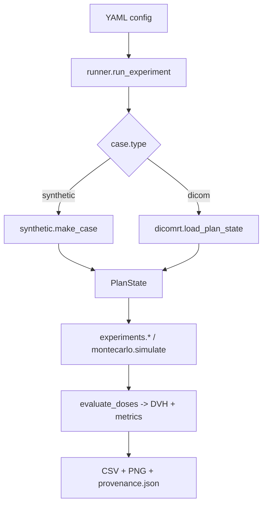

# Design

## Goals and non-goals

**Goals**

1. Quantify how geometric uncertainty *and* grid-handling assumptions change DVHs and plan-quality
   metrics, with both kinds of effect expressed in the same units.
2. Make every number traceable: a perturbation is a small, named, deterministic object; every
   result carries its history and the config that produced it.
3. Run anywhere: a synthetic phantom with an analytic dose lets every effect be explained from first
   principles, and the same code runs on real DICOM-RT.

**Non-goals** (see [limitations](limitations.md)): dose recalculation, proton/heterogeneity effects,
clinical decision support.

## Core idea: one contract for two kinds of uncertainty

```python
class Perturbation(ABC):
    kind: "physical" | "numerical"

    def apply(self, state: PlanState) -> PlanState: ...  # pure; returns a new state
    def describe(self) -> str: ...
```

`PlanState` is immutable and holds

| field | meaning | who touches it |
|---|---|---|
| `dose` | planned dose on its own grid, in the room frame | numerical perturbations (offset, coarsen) |
| `masks` | reference structures on their own grid | read-only; used to rebuild sampling |
| `clouds` | structures as weighted point clouds (`points`, `volumes` in mm³) | physical perturbations (motion); `StructureSampling` rebuilds them |
| `interp_order` | dose interpolation used at sampling | `InterpolationOrder` |
| `history` | ordered descriptions of every perturbation applied | all |

Evaluation is always *"interpolate the dose grid at the cloud points, then build a weighted DVH"*.
Because physical perturbations move only the cloud and numerical ones move only the dose grid or
the sampling, the two never need to know about each other, and they compose by function
application (`Compose`).

## Why these choices

**Static dose cloud (patient moves, dose stays).** Equivalent to shifting the dose by the opposite
displacement for photon beams in near-homogeneous tissue, and it avoids re-computing dose. It is
the standard model behind margin recipes. The equivalence is a unit test
(`test_patient_shift_equals_opposite_dose_grid_shift`): moving the patient by +t and locating the
dose grid at −t give identical structure doses.

**Point clouds, not resampled masks.** Rigid and deformable motion move points exactly. Resampling
a binary mask under a 0.7 mm shift would inject its own discretisation error, which is the thing
we are trying to measure. The one place where mask sampling *is* the question
(`StructureSampling`) rebuilds clouds from the reference masks on the dose grid, and is forbidden
after motion has been applied.

**Exact DVH.** Metrics are computed on sorted weighted samples, not on a histogram, so there is no
bin-width error and perturbations as small as a tenth of a voxel remain visible. Volumes are in
mm³ end to end, so cc-based metrics (`D0.1cc`, `V30Gy_cc`) are correct for fractional-occupancy
sampling.

**Metrics as strings.** `D95%`, `V20Gy`, `HI`, `CI`, `gEUD(a=8)` live in YAML configs and
constraints. The grammar is in [conventions](conventions.md).

**Dose-cloud vs anatomy-sampled metrics.** `GI` and `CI`'s `PIV` are volumes of isodoses in the
dose grid. They are invariant to rigid setup shifts (tested) but respond to grid assumptions;
DVH metrics respond to both. This asymmetry is a deliberate output of the audit.

**Two Monte Carlo engines.** `sampled` draws per-fraction errors explicitly (supports rotations and
any fraction number). `blur` uses the closed-form many-fraction limit for translations (planned dose
convolved with the random-error Gaussian, then shifted by the systematic error), about 10× faster at 20 fractions.
They are cross-checked in the test-suite, and `blur` is the fast path for margin scans.

**Equivalent rigid shift.** `experiments.equivalent_shift_mm` inverts six directional sweeps
(±x, ±y, ±z) to find the smallest axis-aligned rigid shift that moves a metric the *same way* by the
same amount. It is a sign-aware **lower bound**, never an estimate of the true displacement (a metric can
be much steeper along one axis than along the displacement); it is NaN where no rigid shift can move the
metric that way (e.g. raising target coverage). For `DoseGridOffset` scenarios the true displacement is
reported next to it, which makes the equivalent a consistency check there; it carries information for
coarsening, interpolation and structure sampling. Changes below a noise floor are reported as negligible.

## Real-data assembly

Downloaded DICOM does not say which structure set goes with which image or dose.
`dicomrt.discover_cases` follows the references in the headers (RTDOSE → RTPLAN → RTSTRUCT → image
series UID), reads the prescription and fraction count from the RTPLAN, and pairs by
FrameOfReference only when that is unambiguous (reporting why when it is not). `load_plan_state`
additionally warns if the RTSTRUCT does not reference the loaded image series, and the rasteriser
names the ROI whose contours fall outside the image. An experiment that takes a user-supplied
reference dose instead of a plan prescription drops the Rx-dependent metrics and labels the dose
line "reference dose" in figures.

`experiments.contour_variation` is the one experiment that perturbs *geometry from data* rather
than by construction: it swaps the structure masks for alternative contours of the same organs while
the dose stays fixed, and reports each metric change as an equivalent rigid shift, flagged
`rigid_comparable` only when the organ volume is within ±25 %.

## Data flow



## Extending

| To add | Do |
|---|---|
| a perturbation | subclass `Perturbation` in `perturb/`, set `kind`, implement `apply`/`describe` (pure), export it, add it to `default_audit_scenarios()` if it is a convention choice; add a test that the identity setting changes nothing |
| a metric | add a regex + branch in `metrics.compute_metric`, a unit in `metric_unit`, a row in the grammar table |
| a case source | return a `PlanState` (and optionally a CT) from `config.build_state` |
| an experiment | add a branch in `runner.run_experiment`, a validator entry in `config.EXPERIMENTS`, an example YAML (the example-config test picks it up) |

## Performance

Measured on a laptop (macOS, Python 3.13) with the synthetic phantom: 4 structures, about 17 k sample
points in total. One dose interpolation of all points takes about 0.8 ms and `evaluate(state)` about
1.5 ms. `sampled` Monte Carlo costs `n_courses × n_fractions` interpolations (100 courses × 20
fractions ≈ 2.4 s); `blur` costs one per course (≈ 0.2 s per 100 courses, about 12× faster; it also
builds one refined, blurred dose per run). A full grid audit on a real 1 L pancreas target takes
about 20 s; a resolution scan a few seconds per factor. Cubic interpolation re-prefilters the dose
per call: use it for audits, not for large Monte Carlo runs. Mean-squares registration of a full-size
same-grid CT pair (74 × 512 × 512, full sampling) took about two minutes in an independent run;
mutual information uses 25 % random sampling and is faster per iteration.
