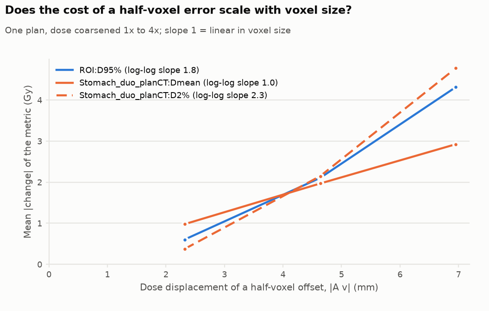

# Experiments

Each experiment is a YAML file in [`experiments/`](../experiments) run with
`doseshift run experiments/<name>.yaml` (or all at once with `doseshift demo`). Outputs go to
`outputs/<name>/`: CSV tables (the "table view" of every figure), PNGs, `nominal.csv`, and
`provenance.json`.

The hypotheses below are what the phantom was built to test. Observed values are for the
synthetic phantom with the demo seeds; treat them as mechanism checks, not clinical results.

## R1: Sensitivity to rigid shift (`shift_sweep.yaml`)

*How do target and OAR metrics respond to translation along each axis?*

Hypotheses: (a) CTV metrics are flat until the shift consumes the CTV-PTV margin, then fall off
quickly; (b) PTV metrics fall immediately because the PTV edge sits in the penumbra; (c) an OAR
responds strongly to shifts toward it and not at all to shifts away.

Observed (phantom; positive y = posterior): CTV D98 stays above 95 % Rx (57 Gy) out to 6.0 mm and
first falls below it at 6.5 mm along y and z and 7.0 mm along x. PTV D95 falls from 57.6 Gy to
52.6-52.7 Gy (±y), 53.7-53.8 Gy (±z) and 54.0-54.1 Gy (±x) at 3 mm. Rectum mean dose rises from
0.85 to 11.0 Gy for a 10 mm anterior shift (−y), drops to 0 Gy for a posterior one (+y), and moves by
less than 0.3 Gy for shifts in x or z.

## R2: Grid-assumption audit (`grid_audit.yaml`)

*Which dose-grid conventions matter, and what are they worth?*

Scenarios (`experiments.default_audit_scenarios`): ±½-voxel centre/corner offsets (per **index** axis
i, j, k and combined), 2× dose coarsening, nearest and cubic interpolation, structures sampled on the
dose grid (binary centre and fractional sub-voxel), and coarsening combined with centre sampling.

Two different kinds of row, which should not be read the same way:

- **Offsets are displacements.** A ½-voxel offset on all axes displaces the dose by |A·v| (2.60 mm on
  the phantom's 3 mm grid) by construction. The audit reports that displacement
  (`displacement_mm`) next to the metric change and the equivalent shift; for these rows the
  equivalent is a consistency check, not a finding. The informative output is what the displacement
  *costs* in dose.
- **Coarsening, interpolation and structure sampling are not displacements.** For them the equivalent
  rigid shift is the useful translation into physical terms.

`equivalent_shift_mm` is a **lower bound**: the smallest axis-aligned shift that moves the metric the
same way (sign-aware). It can be far below the true displacement when the metric is much steeper
along one axis than along the displacement direction (phantom rectum D2%: 1.4 mm for a 2.6 mm
displacement). It is NaN when no rigid shift can move the metric that way: shifts only lower target
coverage, so conventions that *raise* PTV D95 (nearest/cubic interpolation, structure sampling) have
no equivalent.

Hypotheses: effect ≈ local dose gradient × effective displacement, so (a) PTV-edge and OAR
near-maximum metrics are far more sensitive than CTV or mean-dose metrics; (b) the effect of a
half-voxel error along an axis depends on the dose gradient along *that* axis at the structure, so
per-axis effects differ; (c) interpolation order matters little next to a convention error;
(d) `GI` and `PIV` respond to grid assumptions but not to patient shifts.

Observed (phantom): a combined ½-voxel offset (displacement 2.60 mm) costs PTV D95 3.5 Gy (equivalent
2.5 mm, i.e. the displacement is almost fully expressed) and raises rectum D2% by 8.6 Gy (equivalent
1.4 mm; the −½ offset gives −6.3 Gy, 1.6 mm). 2× coarsening costs PTV D95 4.6 Gy (equivalent
2.9 mm). Interpolation order changes PTV D95 by at most 0.75 Gy. Per axis the ½-voxel offset costs
PTV D95 0.75 (i), 1.1 (j) and 1.4 (k) Gy, so (b) holds; for the rectum only the j (≈ y) offset matters
(+9.3 / −6.0 Gy). CTV D98 moves by at most 0.08 Gy for every convention except 2× coarsening (0.54 Gy).
Near-maximum OAR metrics are the most convention-fragile quantity in the phantom audit.

Reading the output: `audit_equivalence.csv` has one row per scenario × metric with `delta`,
`equivalent_shift_mm` (0 = below the noise floor, i.e. negligible; inf = beyond the swept range;
NaN = no rigid shift moves the metric that way), `direction`, and `displacement_mm`.

## R3: Course-level robustness (`monte_carlo_courses.yaml`)

*Given random and systematic setup errors, what is P(constraint met), and how wide is the delivered
DVH band?*

Hypotheses: (a) the planned plan can pass while the course-level probability of passing is far from
1; (b) the delivered PTV DVH degrades much more than the CTV's; (c) probability falls with Σ faster
than with σ for the same nominal magnitude (systematic errors do not average out over fractions).

Observed (5 mm margin, 20 fractions): (a) planned passes, P(CTV D98 ≥ 95 % Rx) = 0.76 ± 0.025
(binomial standard error, 300 courses; 0.76-0.78 over seeds 1-3) with Σ = 2, σ = 3 mm; (b) median PTV D95 47.4 Gy vs 57.6 planned, median CTV D98 59.0 vs 61.7; (c) with
equal magnitude, Σ = 3 mm alone gives P = 0.82 and σ = 3 mm alone gives P = 1.00.

Use `method: blur` for large `n_courses` (translations only), `sampled` when rotations or a small
number of fractions matter.

## R4: Margin check (`margin_scan.yaml`)

*Is the Monte Carlo consistent with the van Herk margin recipe, and how robust is that?*

The phantom places the 95 % isodose on the PTV surface with a 3.2 mm penumbra, close to the recipe's
own assumptions. At 7 mm, the whole-millimetre point next to the 3D recipe margin (6.95 mm for
Σ = 2, σ = 3), P(CTV Dmin ≥ 95 % Rx) is 0.89 ± 0.013 (target 0.90), and in 1D the 90 % point falls near the 1.28·Σ version of the recipe
(≈ 4.5 mm). A regression test pins this to 0.84-0.95.

**This is a consistency check, not a validation, and it is not robust to setup choices.** An
independent reviewer changed one choice at a time at the recipe margin and found P between 0.79 and
0.91: CT mask resolution 1 × 1 × 1.5 mm gave 0.87; dose grid 2 mm 0.91 and 5 mm 0.82; a plateau of 1.00 Rx
(the recipe's own assumption, versus the phantom's 1.04) 0.82; fine masks plus plateau 1.00 0.79 to
0.83. Three effects push the shipped value up: `Dmin` evaluated on voxel centres is biased high, the
1.04 plateau puts the 95 % isodose at 1.36σ rather than 1.64σ, and `blur` means infinitely many
fractions (`blur` ignores `n_fractions`; explicit 20 fractions give 0.855, 5 fractions 0.755).
Note also that D98 instead of minimum dose needs less margin (D98 ignores the outer ~2 % of the
volume), and that the criterion is for a *synthetic* phantom.

`margin_scan` runs only on the phantom (it re-draws the CTV), so it illustrates how margin and
coverage probability relate; it is not a tool for choosing clinical margins.

## R5: Grid audit on real data (`experiments/real/*_audit.yaml`)

*What does a grid assumption cost on clinical plans?* Run the same audit on two Gamma Knife
radiosurgery cases (VS-SEG-135, 154: MR, 1 mm dose grid, 13 Gy from the RTPLAN) and two pancreas
cases (Pancreas-CT-CB_014 on a 2.5 mm dose grid, 017 on a 1.25 mm grid), see
[data/README.md](../data/README.md).

A ½-voxel convention error *is* a displacement of the dose, and its size is set by the grid:
0.87 mm on the 1 mm Gamma Knife grids, 2.3 mm on the 2.5 mm pancreas grid (014), 1.2 mm on the
1.25 mm grid (017). That part is true by construction. What the real data adds is its cost in dose
(columns are the −½ / +½ offset on all axes, then 2× coarsening with centre sampling; "eq" is the
sign-aware lower-bound equivalent shift):

| case | metric (planned) | −½ voxel | +½ voxel | coarsen ×2 + centre |
|---|---|---|---|---|
| VS-SEG-135 | TV D95% (13.33 Gy) | −0.86 Gy (eq 0.49 mm) | −1.62 Gy (eq 0.81 mm) | −0.55 Gy (eq 0.35 mm) |
| VS-SEG-154 | TV D95% (13.22 Gy) | −0.92 Gy (eq 0.65 mm) | −0.74 Gy (eq 0.58 mm) | −0.41 Gy (eq 0.41 mm) |
| Pancreas-014 | ROI D95% (31.7 Gy) | −0.95 Gy (eq 2.00 mm) | −0.25 Gy (eq 0.77 mm) | −0.35 Gy (eq 0.94 mm) |
| Pancreas-014 | stomach/duodenum D2% (48.6 Gy) | −0.10 Gy (negligible) | +0.65 Gy (eq 1.60 mm) | +0.96 Gy (eq 2.01 mm) |
| Pancreas-017 | ROI D95% (23.7 Gy) | −0.27 Gy (eq 0.31 mm) | −0.43 Gy (eq 0.48 mm) | −0.69 Gy (eq 0.68 mm) |

What it says, and what it does not:

- **Voxel-size scaling is tested properly in R7** (one plan, many grids), not here.
- **Relative to the plan the cost is largest for the small tumour:** 1.6 Gy is 12 % of the 13 Gy
  prescription for the 1 cc tumour in VS-SEG-135, against 3 % for the pancreas ROI D95%.
- **The equivalents are lower bounds on a displacement that is known**, so they mostly show how
  steeply each metric responds, not how large the error is. They are not evidence that effects
  "scale with voxel size": the four plans differ in grid, site, structure and gradient at once
  (the 1.25 mm pancreas grid, 017, gives 0.3-0.7 mm; the 1 mm Gamma Knife grids 0.4-0.8 mm), and
  four plans cannot separate those.
- **Which metrics move.** Over all scenarios, target low-dose-tail metrics are the fragile ones
  (pancreas ROI D98%: up to 24-25 % change, D95%: ≈ 3 %, median and mean < 1 %). For the real OARs
  mean dose is *not* safe: stomach/duodenum Dmean moves up to 4.9 % and small-bowel Dmean up to 3.9 %
  in patient 014, more than their D2% (2.0 % and 0.9 %), because these organs lie across the dose
  gradient. The phantom's finding that near-maximum OAR metrics are the fragile ones does not carry
  over unchanged.
- **Tiny structures are quantisation-limited.** The 0.07 cc cochlea has 146 samples natively and 5
  after 2× coarsening with centre sampling, where D2% = Dmax; that row (−1.06 Gy, "eq 3 mm") measures
  how the structure is sampled, not where the dose is, and the tool now warns below 30 samples.
- Equivalent-shift values for metrics that barely change (|Δ| of a few tenths of a Gy, e.g. the 017
  stomach/duodenum D2% rows) are ill-conditioned; read them together with `delta`.

## R6: Measured contour variation (`experiments/real/pancreas_*_contours.yaml`)

*How much does an organ's dose metric change when its contour is redrawn on a later image, with the
dose held fixed, and how big a rigid shift is that worth?* The pancreas collection provides stomach/
duodenum and small-bowel contours on the planning CT and on two CBCT-day images (same frame of
reference), so this is a measured geometric perturbation rather than an assumed one.

`contour_variation` reports Dice, volumes and centroid shift next to each metric change, plus
`rigid_comparable` (organ volume within ±25 %). Where the volume changed more, the contour
*definition or extent* differs and a mm-equivalent is not meaningful; for those rows
`equivalent_shift_mm` is NaN (shown as "n/a" in the figure) while the metric change, Dice and volumes
are still reported.

Observed:

| patient | organ | volume change | Dice | centroid shift | D2% change | rigid-equivalent |
|---|---|---|---|---|---|---|
| 017 | stomach/duodenum | +6 % | 0.65 / 0.71 | 8.9 / 5.4 mm | +1.6 / +0.5 Gy | 5.4 / 2.5 mm |
| 017 | small bowel | −4 % / −5 % | 0.49 / 0.54 | 12.8 / 8.9 mm | +0.3 / +0.08 Gy | 4.1 mm / negligible |
| 014 | stomach/duodenum | ×1.7 / ×2.4 | 0.67 / 0.55 | 3.6 / 11.2 mm | +5.5 / +7.8 Gy | n/a (volume changed) |
| 014 | small bowel | ×3.3 / ×4.7 | 0.32 / 0.26 | 29 / 36 mm | −2.0 / −1.5 Gy | n/a (volume changed) |

(two values = CBCT 1 / CBCT 2). For patient 017 the stomach/duodenum change is worth 2.5-5.4 mm of
rigid shift (a lower bound along the best axis, here −x, while the stomach/duodenum centroid actually moved
5-9 mm, mostly in z), larger than any displacement in R5 (at most 2.3 mm); the small-bowel D2% rows are
ill-conditioned (a +0.3 / +0.08 Gy change). Patient 014's CBCT contours cover 1.7-4.7× the volume of
the planning ones, which is a difference in what was contoured, not just where; the tool's refusal
to turn that into mm is the intended behaviour. Both patients are a sample of two.

## R7: Does the cost of a half-voxel error scale with voxel size? (`resolution_scan`)

R5 compares four different plans, which cannot separate voxel size from site and dose gradient. This
experiment keeps **one plan** and coarsens its dose 1× to 4× (`resolution_scan.yaml`,
`experiments/real/*_resolution.yaml`), applying the ±½-voxel offset to each coarsened plan and
measuring the change against that coarsened plan. Only voxel size varies.

| plan | metric | cost over the displacements scanned | log-log slope |
|---|---|---|---|
| phantom | PTV D95% | 3.6 → 23.5 Gy (2.6 → 10.4 mm) | 1.4 |
| phantom | rectum D2% | 7.4 → 18.2 Gy (saturates) | 0.6 |
| VS-SEG-135 | TV D95% | 1.24 → 4.11 Gy (0.9 → 3.5 mm) | 0.9 |
| VS-SEG-135 | TV Dmean | 0.26 → 2.24 Gy | 1.6 |
| VS-SEG-154 | TV D95% | 0.83 → 4.68 Gy | 1.3 |
| Pancreas-014 | ROI D95% | 0.60 → 4.32 Gy (2.3 → 7.0 mm) | 1.8 |
| Pancreas-014 | stomach/duodenum Dmean | 0.98 → 2.92 Gy (0.42 Gy/mm throughout) | 1.0 |
| Pancreas-017 | ROI D95% | 0.35 → 1.37 Gy (1.2 → 4.6 mm) | 0.9 |
| Pancreas-017 | stomach/duodenum D2% | 0.13 → 1.04 Gy | 1.5 |

Yes, on a single plan the cost grows with voxel size. It is roughly linear in the displacement for
gradient-limited metrics (slope about 0.9-1.0), steeper (1.3-2.3) for metrics that depend on
curvature or a threshold crossing (target mean dose, D95 when the displacement starts to exceed the
penumbra), and it saturates once the displacement exceeds the penumbra (the phantom rectum D2%).
The cost per millimetre of displacement is specific to the plan and metric (0.06-1.6 Gy/mm across
these plans), so a cost measured on one plan cannot be transferred to another. Caveats: coarsening
also smooths the dose, so each coarse grid is a different plan; the slopes come from 3-4 points per
metric; four real plans.

## R8: CT-to-CBCT registration across scanners (`scripts/cbct_registration.py`)

*Can the registration module align a CBCT to a planning CT, and could that give setup errors?*

Validated with ground truth (`tests/test_registration.py`, `tests/test_real_data.py`): a known rigid
motion is applied and the "scan" is re-made on a coarser anisotropic grid with an unrelated frame
origin, a nonlinear intensity remap, blur and noise; mutual information with a centroid start then
recovers the motion to ≤ 0.04 mm / ≤ 0.5° on the phantom CT and ≤ 1.0 mm / ≤ 0.14° on the real pancreas
planning CT, from starts up to 12 mm off.

On the real pancreas CBCTs there is no ground truth, so the script reports diagnostics instead:

- The dataset's own placement of each CBCT into the planning frame ("Aligned CT" series) is a **pure
  translation** (rotation ≤ 0.07°), recovered by same-modality registration; pairing is unambiguous
  (residual MSE 1,654-5,219 for true pairs against about 80,000 for wrong ones).
- Mutual-information registration of each CBCT to the planning CT is well defined for only **one of
  the four**: Pancreas-014's CBCT 1 gives the same answer from every start (start spread 0.63 mm;
  differs from the dataset placement by (1.9, 3.3, 7.1) mm and 2.3° about y). Its CBCT 2 depends on the
  start (spread 4.3 mm, difference from the dataset placement 23 mm) and both of Pancreas-017's CBCTs
  do so strongly (spread 12-13 mm, about 30 mm along z). The CBCT field of view is truncated
  (262 × 262 × 184 mm against a full-body planning CT) and organs move, so the metric is weakly
  constrained.

Consequence: these registrations are **not** a source of setup errors. Besides being unreliable, the
CBCT frame is unrelated to the planning frame and the collection has no RTPLAN (no isocentre), so a
translation cannot be read as a setup error even where the optimum is well defined. An empirical
error model from this data is therefore not feasible; it needs images whose frames are related
(planning isocentre known) and a reference alignment. The start spread is the diagnostic to look at
before trusting any such registration.

## Adding an experiment

See *Extending* in [design.md](design.md).
